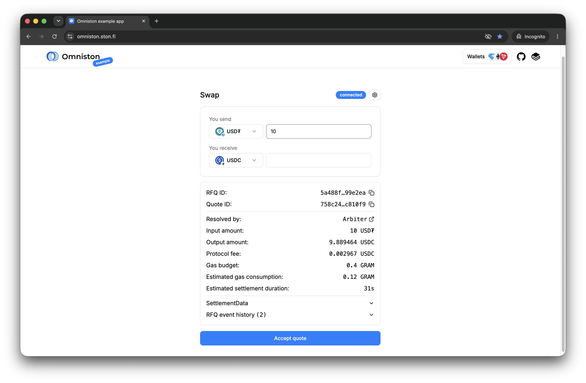

# Omniston React example app

STON.fi maintains this React example app to demonstrate Omniston SDK integration with React and Next.js. Use its source code alongside the official [Omniston documentation](https://docs.ston.fi/docs/developer-section/omniston) and [React SDK guide](https://docs.ston.fi/developer-section/omniston/sdk/react).

Try the live example app at [omniston.ston.fi](https://omniston.ston.fi).



The implementation keeps code minimal for readability. It uses mocked asset lists and metadata in [`queries/`](./queries) to avoid maintaining integrations with third-party APIs.

> [!WARNING]
> This example app is intended for integration guidance and is not production-ready.

## Development

Use Node.js 24 and pnpm 12.12.0 (the version pinned in the root `package.json`). From the repository root, install dependencies and start the example app:

```sh
pnpm install
pnpm dev
```

The root development command builds the local SDK packages before starting Next.js. Open [localhost:3000](http://localhost:3000) once the server is ready.

The [`.env.development`](./.env.development) file defines the default development configuration. To customize endpoints, wallet configuration, or asset query conditions, add local overrides in `examples/react-app/.env.development.local`.

## Deployment

For deployment options and instructions, see the official [Next.js deployment documentation](https://nextjs.org/docs/app/getting-started/deploying).
